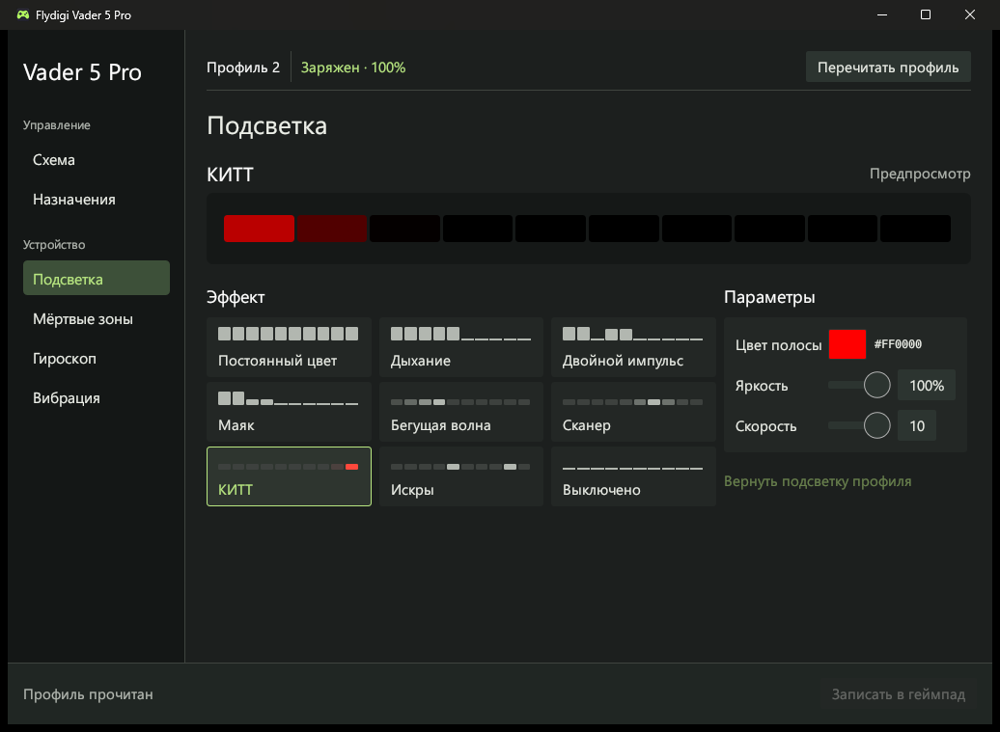

# Flydigi Vader 5 Pro

Прыжок на заднем лепестке, короткий ход курка, красный сканер в стиле КИТТ. Настройте свой Vader 5 Pro под любимую игру и проверьте отклик прямо в редакторе.

**[Скачать для Windows или Linux →](https://github.com/intercontinentalmassacre/vader5/releases/latest)**

Для Windows выберите `vader5.exe`, для Ubuntu x86-64 — пакет `.deb`. Интерфейс на русском.



## Что можно настроить

- **Кнопки и лепестки.** Нажмите лепесток — подсветится его карточка с текущим назначением. Выберите новое действие прямо на схеме или в списке.
- **Стики и курки.** Сдвиньте границу мёртвой зоны и медленно нажмите LT. Две шкалы рядом покажут, где курок срабатывает сейчас и что изменится после записи. Для стиков ту же разницу видно по движению двух точек.
- **Подсветка.** Выберите спокойное дыхание, искры или узкий сканер КИТТ. Подберите цвет и скорость по тому, как движется полоса в предпросмотре.
- **Гироскоп и вибрация.** Проверьте поворот по каждой оси и по отдельности включите моторы рукояток и курков. Сразу почувствуете, какой мотор настраиваете.

Подключите геймпад по USB или через приёмник в режиме XInput. Редактор сам найдёт его и покажет заряд. Если подключено несколько геймпадов, выберите нужный в списке. Когда всё устроит, нажмите **«Записать в геймпад»**.

## Сборка из исходников

Понадобится Rust 1.94 или новее.

**Windows x64** · Установите инструменты сборки Visual Studio для C++ и Windows SDK. Исполняемый файл появится в `target/release/vader5.exe`.

```powershell
cargo build --release --locked
```

**Ubuntu / Debian x86-64** · Следующие команды соберут пакет с приложением, иконкой и правилом доступа к геймпаду. Готовый файл появится в `target/linux/`.

```sh
sudo apt install build-essential pkg-config libudev-dev dpkg-dev
sh linux/package-deb.sh
```

[Благодарности](docs/credits.md)
